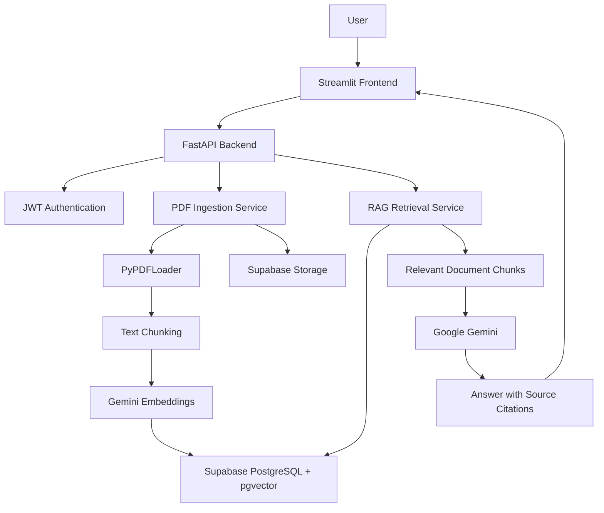

# PDF RAG Assistant

A full-stack PDF Question Answering application built with **FastAPI, LangChain, Google Gemini, PostgreSQL, pgvector and Streamlit**.

Upload PDF documents and ask questions about their contents. The application uses Retrieval-Augmented Generation (RAG) to retrieve relevant information and generate answers with source citations.

## Live Demo

- **Frontend:** https://smart-pdf-rag.streamlit.app/
- **Backend API:** https://pdf-rag-assistant-4a95.onrender.com
- **API Documentation:** https://pdf-rag-assistant-4a95.onrender.com/docs

## Features

- PDF upload and text extraction.
- Automatic text chunking and embedding generation.
- Semantic search using vector similarity.
- AI-powered answers using Google Gemini.
- Source citations with PDF filenames and page numbers.
- Google authentication and JWT-based authentication.
- User-specific document isolation.
- Persistent chat history and conversations.
- Cloud PDF storage using Supabase Storage.
- PostgreSQL database with pgvector.
- Local development support using SQLite and LanceDB.
- REST API built with FastAPI.
- Streamlit-based frontend.

## Technology Stack

| Category | Technologies |
|---|---|
| Backend | Python, FastAPI |
| AI / RAG | LangChain, Google Gemini |
| Embeddings | Gemini Embedding API |
| Vector Database | PostgreSQL, pgvector, LanceDB |
| Database ORM | SQLModel |
| Cloud Database | Supabase |
| File Storage | Supabase Storage |
| Authentication | JWT, Google OAuth |
| Frontend | Streamlit |
| Deployment | Render, Streamlit Community Cloud |
| Containerization | Docker, Docker Compose |
| Testing | Pytest, HTTPX |

## Architecture



## How It Works

### 1. PDF Ingestion

- User uploads a PDF document.
- PyPDFLoader extracts the document text.
- RecursiveCharacterTextSplitter divides the text into smaller chunks.
- Gemini generates vector embeddings for each chunk.
- Original PDF files are stored in Supabase Storage.
- Text chunks, metadata and embeddings are stored in PostgreSQL using pgvector.

### 2. Question Answering

- User submits a question.
- Gemini generates an embedding for the question.
- pgvector performs semantic similarity search.
- Relevant document chunks are retrieved for the authenticated user.
- Retrieved content is passed to Google Gemini.
- Gemini generates an answer based on the retrieved context.
- The application returns the answer with source filenames and page numbers.

### 3. Authentication and Data Isolation

- Users can register and log in.
- Google authentication is supported.
- JWT tokens protect private API endpoints.
- Documents and vector retrieval are filtered by user ID.
- Conversation history is associated with individual users.

## Project Structure

```text
pdf-rag-assistant/
│
├── app/
│   ├── database/
│   │   ├── database.py
│   │   └── models.py
│   │
│   ├── routes/
│   │   ├── auth.py
│   │   ├── documents.py
│   │   ├── questions.py
│   │   └── conversations.py
│   │
│   ├── services/
│   │   ├── auth_service.py
│   │   ├── auth_dependencies.py
│   │   ├── ingestion_service.py
│   │   └── rag_service.py
│   │
│   ├── main.py
│   └── schemas.py
│
├── tests/
│   └── test_api.py
│
├── data/
├── frontend.py
├── generation.py
├── ingestion_pipeline.py
├── retrieval.py
├── rag_pipeline.py
│
├── Dockerfile
├── docker-compose.yml
├── requirements.txt
├── .gitignore
└── README.md
```

## Installation and Local Setup

### Prerequisites

- Python 3.12
- Git
- Google Gemini API key

### 1. Clone the repository

```bash
git clone https://github.com/mahesh-bagali/pdf-rag-assistant.git
```

```bash
cd pdf-rag-assistant
```

### 2. Create a virtual environment

Windows PowerShell:

```powershell
py -3.12 -m venv .venv312
```

Activate it:

```powershell
.\.venv312\Scripts\Activate.ps1
```

### 3. Install dependencies

```powershell
python -m pip install -r requirements.txt
```

### 4. Configure environment variables

Create a `.env` file in the project root.

Add the required configuration:

```env
GOOGLE_API_KEY=your_google_gemini_api_key

AUTH_SECRET_KEY=your_jwt_secret_key
ACCESS_TOKEN_EXPIRE_MINUTES=30

GOOGLE_CLIENT_ID=your_google_oauth_client_id

DATABASE_URL=

SUPABASE_URL=
SUPABASE_SERVICE_ROLE_KEY=
```

Use your own credentials. Never commit `.env` or expose API keys and service-role keys publicly.

For local development, SQLite and LanceDB are used as fallback storage when cloud database and Supabase configuration are not provided.

### 5. Run the FastAPI backend

```powershell
uvicorn app.main:app --reload
```

Backend:

```text
http://127.0.0.1:8000
```

API documentation:

```text
http://127.0.0.1:8000/docs
```

### 6. Run the Streamlit frontend

Open another terminal, activate the virtual environment and run:

```powershell
streamlit run frontend.py
```

## Docker Setup

Docker is supported for running the backend API.

Build and start the application:

```bash
docker compose up --build
```

The API is available at:

```text
http://localhost:8002
```

Stop the container:

```bash
docker compose down
```

Configure the required environment variables before starting the container.

## API Endpoints

### Authentication

| Method | Endpoint | Description |
|---|---|---|
| POST | `/auth/register` | Register a user |
| POST | `/auth/login` | User login |
| GET | `/auth/me` | Get authenticated user |
| POST | `/auth/google` | Google authentication |

### Documents

| Method | Endpoint | Description |
|---|---|---|
| POST | `/documents/upload` | Upload and process a PDF |
| GET | `/documents` | List uploaded documents |

### Questions

| Method | Endpoint | Description |
|---|---|---|
| POST | `/questions/ask` | Ask questions about uploaded PDFs |

### Conversations

| Method | Endpoint | Description |
|---|---|---|
| GET | `/conversations` | List conversations |
| GET | `/conversations/{conversation_id}` | Get conversation details |
| DELETE | `/conversations/{conversation_id}` | Delete a conversation |

All private endpoints require authentication.

## Database Design

The application uses SQLModel for relational database operations.

Main relational tables:

- `users`
- `uploaded_documents`
- `conversations`
- `messages`

Vector storage:

- `pdf_chunks`

The `pdf_chunks` table stores document chunks, metadata, user IDs and 3072-dimensional embeddings.

The `match_pdf_chunks` PostgreSQL function performs similarity search while filtering results by authenticated user ID.

## Testing

Run the test suite:

```powershell
python -m pytest -v
```

The project has passed **19 automated tests** in the local test suite.

## Deployment

The application is deployed using:

- **Backend:** Render
- **Frontend:** Streamlit Community Cloud
- **Database:** Supabase PostgreSQL
- **Vector Search:** Supabase pgvector
- **PDF Storage:** Supabase Storage
- **Authentication:** Google OAuth and JWT

## Future Improvements

- Document deletion with complete storage and vector cleanup.
- Background processing for large PDF uploads.
- Improved upload progress tracking.
- Advanced retrieval and ranking.
- Expanded integration and security testing.

## Author

**Mahesh Bagali**

GitHub: https://github.com/mahesh-bagali

---

If you find this project interesting, feel free to explore the repository and try the live application.